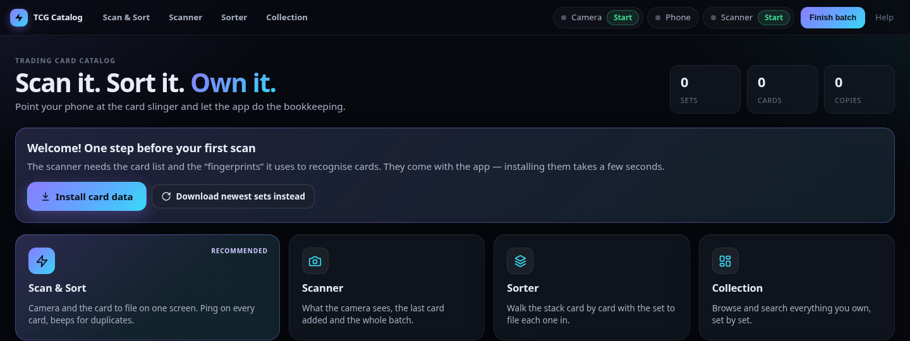

# TCG Catalog

Catalog your Pokémon card collection with your phone. Put a card in a card stand, the phone camera
recognises it, and the app keeps track of what you own, flags duplicates and tells you which set
pile each card goes in. Everything runs on your own computer — no account, no subscription.

---

## What you need

- A **computer** — Windows 10/11, a Mac, or Linux.
- A **phone with a camera** — Android with Chrome works best (the app can use its flashlight).
  iPhone with Safari works too.
- **Both on the same Wi-Fi.**
- Something to hold the phone **above the card**, pointing down — for example a 3D-printed
  "Card Slinger", or any stand with a **dark, matte** spot for the card.

---

## Install (one time)

Go to the **[Releases page](https://github.com/fernandocc/tcg-catalog/releases/latest)** and, under
*Assets*, download the file for your computer. Nothing else needs to be installed first.

| Computer | Download |
|---|---|
| Windows 10 / 11 | `TCG-Catalog-…-Windows-Setup.exe` |
| Mac with an Apple chip (M1 or newer) | `TCG-Catalog-…-Mac-AppleSilicon.dmg` |
| Older Mac with an Intel chip | `TCG-Catalog-…-Mac-Intel.dmg` |
| Linux | `TCG-Catalog-…-Linux-x86_64.AppImage` |

Not sure which Mac you have? Apple menu → **About This Mac**: “Chip: Apple M…” means Apple chip,
“Processor: Intel…” means Intel.

The app isn't signed with a paid developer certificate, so the first time your computer warns about
an unknown developer. That's expected — here's how to get past it once:

### Windows

1. Double-click the downloaded `…Setup.exe`. If a blue **“Windows protected your PC”** box appears,
   click **More info → Run anyway**.
2. Click through the installer (no administrator password needed). It adds **TCG Catalog** to the
   Start menu and the desktop, and opens the app at the end.
3. When Windows asks whether TCG Catalog may use the network, tick **Private networks** and click
   **Allow** — that lets the phone talk to the app.

### Mac

1. Open the downloaded `.dmg` and drag **TCG Catalog** onto the **Applications** folder.
2. Open it from Applications. macOS says it *can't be opened* or *can't check it for malicious
   software* — click **Done/OK**, then open **System Settings → Privacy & Security**, scroll down and
   click **Open Anyway** next to TCG Catalog, and confirm. You only do this once.
3. If macOS asks whether TCG Catalog may find devices on your local network or accept incoming
   connections, choose **Allow**.

### Linux

1. Right-click the downloaded `.AppImage` → **Properties → Permissions** → tick **Allow executing
   file as program** (or run `chmod +x TCG-Catalog-*.AppImage`), then double-click it. The first run
   adds TCG Catalog to your applications menu.
2. If your firewall is on, allow the phone port once:
   `sudo ufw allow from 192.168.0.0/16 to any port 8443 proto tcp`

The app runs in your **web browser** — opening TCG Catalog opens a browser tab. Open it again any
time from the Start menu / Applications / app menu; to close it, use **Quit app** on the Home page.

---

## Use it

Everything happens in the browser window — the **Help** link at the top right explains each screen.

1. **Connect the phone.** On the Home page, scan the **QR code** with the phone's camera. The phone
   warns that the connection “is not private” — that's expected (the page comes from your own
   computer): tap **Advanced → Proceed**. With the card stand empty, tap **Start camera**.
2. **Start scanning.** Press **Start** next to **Scanner** in the top bar and open **Scan & Sort**.
   Feed cards one at a time. Each one is added automatically and the phone pings:
   a rising ping for a new card, two low beeps for a duplicate.
3. **Sort.** Keep the cards in the order you scanned them. The **Sorter** walks through them and
   shows the set each one belongs to. Its **Report** lists the new cards by position so you can pull
   them out of a stack of duplicates quickly.
4. **Finish the batch.** Press **Finish batch** (top bar, click twice). The batch is saved to your
   collection and backed up. Browse everything under **Collection**.

---

## Good to know

- **Your collection** is saved in a **TCG Catalog** folder inside your **Documents** folder
  (the Home page shows where, with an **Open folder** button). *Finish batch* backs it up
  automatically, and **Back up now** makes a copy any time. Moving to a new computer? Install the
  app there and copy the whole folder across.
- **New card sets:** press **Check for new sets** on the Home page (needs internet).
- **Updating the app:** download the newest file from the Releases page and install it the same way.
  Your collection folder isn't touched by installing, updating or uninstalling.
- **Foil cards** reflect light and are harder to recognise. Tilt them slightly or add them by hand,
  then pick *Holofoil* / *Reverse holo* in the Sorter.

## Trouble?

Open the app's **Help** page → *Troubleshooting*. The most common fixes:

| Problem | Fix |
|---|---|
| The phone page won't open | Same Wi-Fi? Camera server running (green dot in the top bar)? Allow Python through the firewall (see Install). |
| Top bar says “Waiting for phone” | The phone went to sleep or the page closed. Reopen it and tap **Start camera**. |
| Red “Can't see the whole Slinger” banner | The phone moved. Re-centre it so the whole dark area is in view. |
| Cards aren't recognised | Empty the stand, tap **Relock** on the phone, soften the lights. New set? **Check for new sets**. |

---

*For developers:* run from source with `bash install.sh` (creates `./venv`, data stays in the
project folder). `tcg_catalog.spec` builds the app with PyInstaller; `.github/workflows/build.yml`
builds the Windows installer, macOS disk images and Linux AppImage when a `v*` tag is pushed.
`tools/make_seed.py` refreshes the bundled card data (`data/catalog_pokemon.json.gz`).
